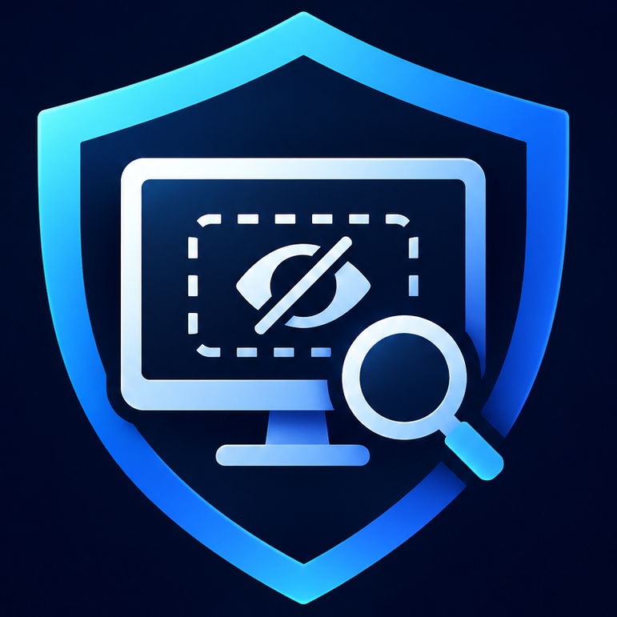
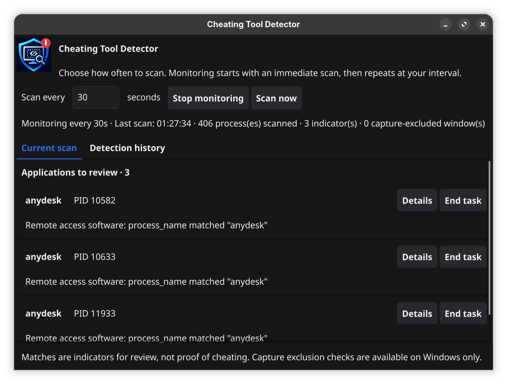

<div align="center">
  
  <h1>Cheating Tool Detector</h1>
  <p>Find common cheating tools and apps that hide their windows from supported screen sharing on Windows.</p>
</div>

The app checks running programs against built-in indicators. On Windows, it also looks for windows marked to stay out of supported screen recordings and shares, even when the app is custom or not in the built-in list. On Linux, it checks application indicators; the screen-sharing check is not available.

## See the app



## Get started

Download the build for your computer from [GitHub Releases](https://github.com/alshahreyaj/cheating-tool-detector/releases):

- **Windows:** download and open `detector-windows-amd64.exe`.
- **Linux:** download `detector-linux-amd64`, then open a terminal in its folder and run:

  ```sh
  chmod +x detector-linux-amd64
  ./detector-linux-amd64
  ```

These builds are for 64-bit computers. If no release is available yet, open the repository's **Actions** tab, choose the latest successful **Build binaries** run, and download the artifact for your system.

No setup or custom rules are needed to start scanning.

## Use the app

1. Choose how often to scan. The default is every 30 seconds.
2. Select **Start monitoring**. A scan runs immediately and repeats at your chosen interval. You can change the interval while monitoring or select **Scan now**.
3. Review any applications listed under **Current scan**. **Details** shows more information; **End task** asks for confirmation before closing the application.

The app icon indicates when a match is present, and a new match may trigger a desktop notification. **Detection history** records when a flagged application appears, disappears, or changes.

> A match is a reason to review an application, not proof of cheating. Some legitimate applications keep protected windows out of screen capture. Ending an application may discard unsaved work.

## Privacy

Scans run on your device. Detection history is saved in your user settings folder. The app does not send scan results to a server.

## Learn more

See the [Developer Guide](DEVELOPER_GUIDE.md) for how detection works, custom rules, command-line use, building, and release instructions.
